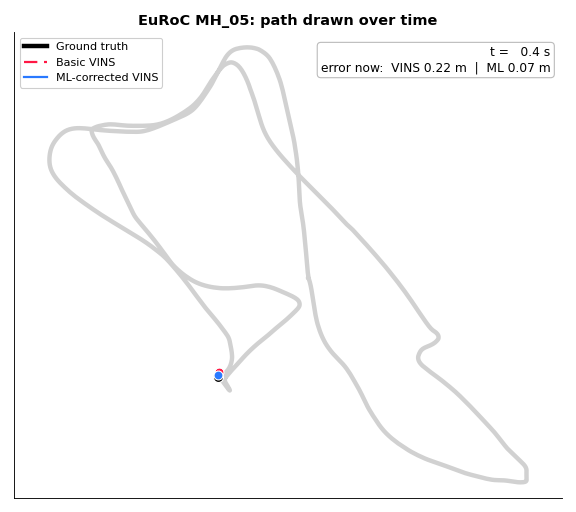
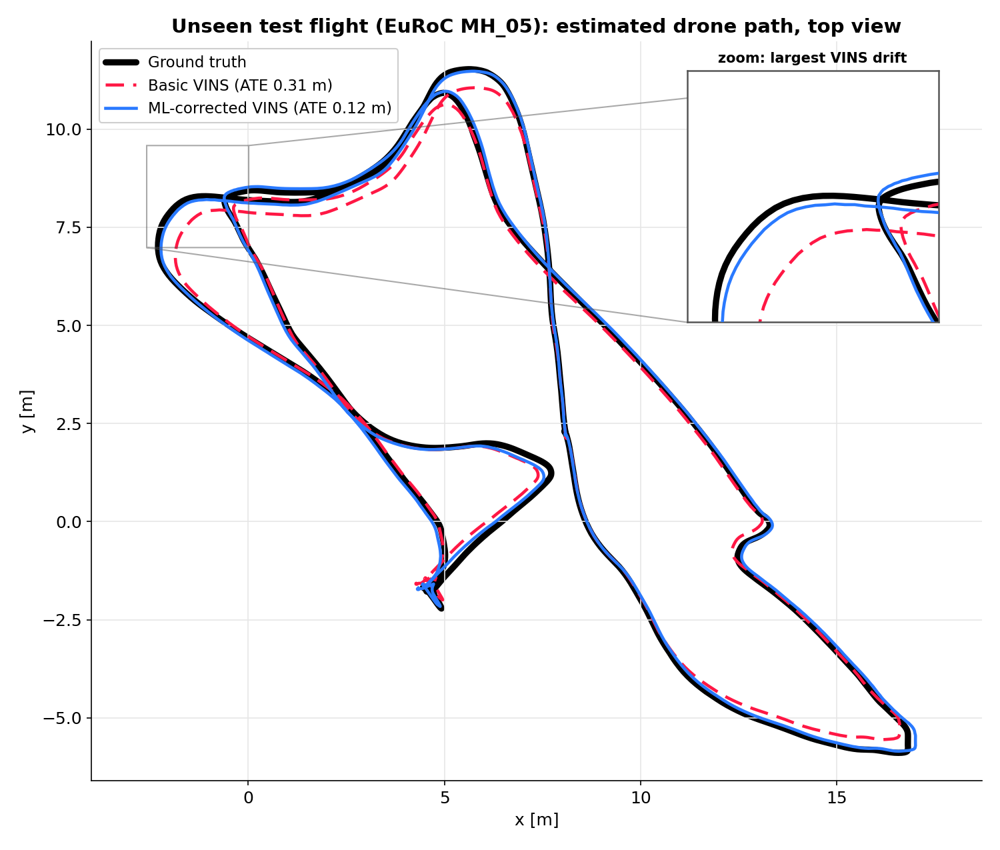
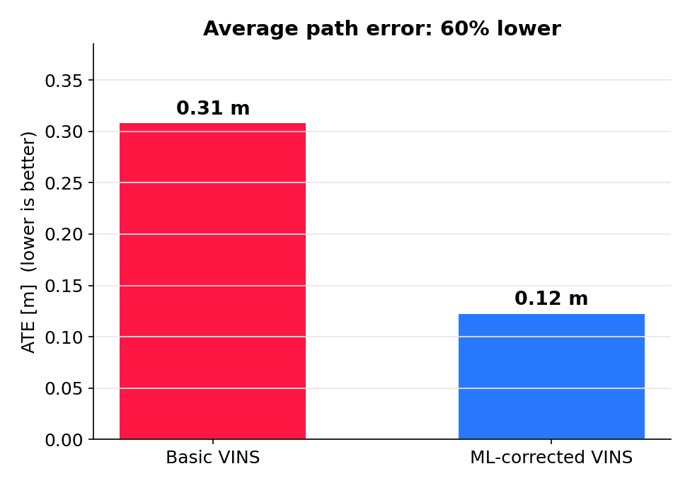
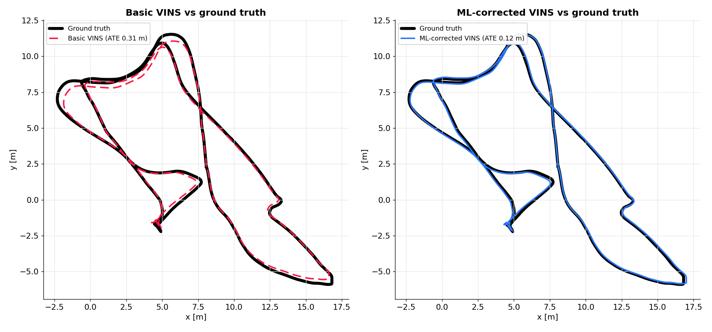
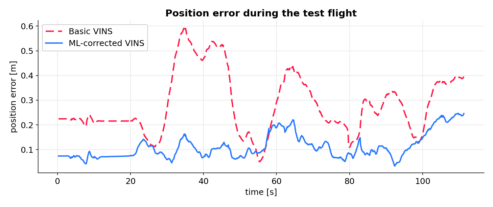

# Drone Trajectory Correction

ML-corrected VINS trajectory without GPS.

*The flight drawn over time: ground truth (black), basic VINS (red), ours (blue).*

**Abbreviations**
- **VINS**: Visual-Inertial Navigation System (VINS-Fusion)
- **IMU**: Inertial Measurement Unit (accelerometer + gyroscope)
- **GPS**: Global Positioning System
- **ML**: Machine Learning
- **ATE**: Absolute Trajectory Error, the average distance between the estimated path and the true path
- **EuRoC MAV**: European Robotics Challenge Micro Aerial Vehicle dataset

## Overview

VINS-Fusion estimates a drone's path from a camera and an IMU when GPS is not available, but its estimated path slowly drifts away from the real one. We add a machine-learning correction layer on top of the unchanged VINS-Fusion. The result is an estimated path that stays much closer to the true flight path.

*Unseen test flight: our ML-corrected path (blue) follows the ground truth (black) more closely than basic VINS (red).*

## What we did

- Integrated VINS-Fusion with an ML model to improve its estimated track.

## Sources

- **Dataset:** EuRoC MAV dataset, ETH Zurich, Machine Hall flights MH_01 to MH_05. The model learned from MH_01–MH_04 and was tested on MH_05 ("difficult"), a flight it never saw during training.
- **Navigation system:** VINS-Fusion, HKUST Aerial Robotics Group ([github.com/HKUST-Aerial-Robotics/VINS-Fusion](https://github.com/HKUST-Aerial-Robotics/VINS-Fusion))

## Result

On the unseen test flight, the ML-corrected path follows the ground truth much more closely than basic VINS.

- Basic VINS ATE: **0.31 m**
- ML-corrected VINS ATE: **0.12 m** (about **60% lower**)

*Average path error (ATE) on the unseen flight. Lower is better.*

## More plots

*Left: basic VINS vs truth. Right: ours vs truth.*

*Position error during the flight: the corrected estimate stays lower for most of the flight.*
